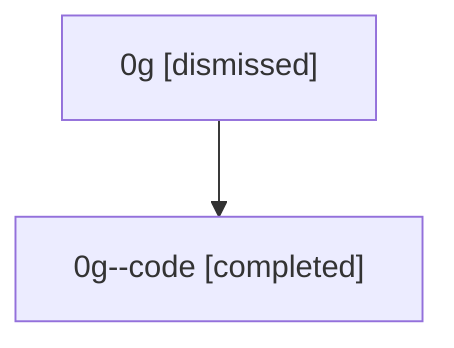

# Session: 0g

[Agent Hoods](../README.md) / [bbugyi200](../users/bbugyi200/README.md) / [athena](../users/bbugyi200/machines/athena/README.md) / [0g](../users/bbugyi200/machines/athena/hoods/0g/README.md) / 0g

Owner: `bbugyi200.athena` · Hood: `0g` · Members: 2

## Lineage

The diagram is an optional enhancement; the ordered table below contains the same lineage in accessible text.

| Role | Agent | State | Model / provider | Timing | Commits | Prompt | Chat |
|---|---|---|---|---|---:|---|---|
| root | 0g | dismissed | claude-fable-5 / claude | 2026-07-07T11:34:46.343978 → 2026-07-07T11:51:38.337032 | [1](../agents/bbugyi200.athena.0g/README.md#commits) | [Prompt](../agents/bbugyi200.athena.0g/prompt.md) | [Chat](../agents/bbugyi200.athena.0g/chat.md) |
| code | 0g--code | completed | gpt-5.5 / codex | 2026-07-07T15:41:35.963016+00:00 | [1](../agents/bbugyi200.athena.0g--code/README.md#commits) | — | [Chat](../agents/bbugyi200.athena.0g--code/chat.md) |

## Commits

| Role | Repo | Commit | Subject | Committed |
|---|---|---|---|---|
| root | — | `3a19944` | chore: Add SDD prompt and plan for active\_runs | 2026-07-07 11:41:34 EDT |
| code | — | `d7497b2` | feat: show active workflow runs | 2026-07-07 11:51:26 EDT |

## Neighbors

| Agent | Relation | State |
|---|---|---|
| [0g.f1](bbugyi200.athena.0g.f1.md) (session · 2) | descendant | completed 1, dismissed 1 |
